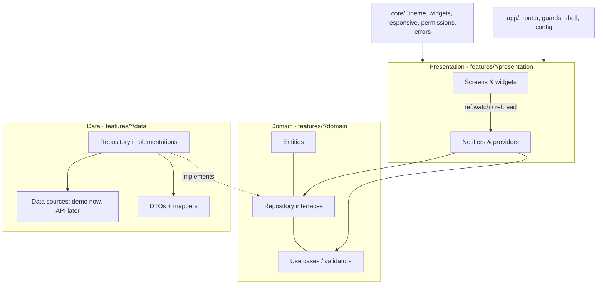

# Architecture

Staffline is a Flutter Web app (Q-02) that is responsive from 320 px to 1920 px. It uses Riverpod for state and dependency injection, and go_router for navigation. There is **no backend yet** (Q-01): every feature talks to repository interfaces, and the only implementation is an in-memory demo one.

## Layers



Rules:
- Widgets never call data sources. They do not hold business rules or calculations (durations, balances, progress percentages). That logic lives in domain code and is unit-tested.
- Repositories throw a typed `Failure` (`core/errors/failure.dart`). Notifiers expose `AsyncValue` (loading, data or error). Widgets show `failure.message` and never parse raw exceptions.
- Permissions in the client only decide what is *shown*. A backend must authorise every request (PRD §11). Until there is one, nothing is production-secure.

## Folders (final, Phase 8)

```text
lib/
├── main.dart                        runApp(ProviderScope(...)) — nothing else
├── app/
│   ├── app.dart                     MaterialApp.router + theme
│   ├── config/app_config.dart       --dart-define flags (SHOW_DEV_TOOLS)
│   ├── router/                      paths, destinations, guards, router, 404
│   ├── shell/                       responsive shell: sidebar / rail / drawer, top bar
│   └── dev/                         demo-only: design gallery, "not built yet"
├── core/
│   ├── theme/                       colour, type, spacing tokens; ThemeData
│   ├── responsive/                  breakpoints, ResponsivePage, ResponsiveGrid
│   ├── widgets/                     design-system components
│   ├── permissions/                 modules × actions, scope, PermissionSet
│   ├── errors/                      Failure types
│   └── utils/
├── shared/
│   └── models/app_session.dart
└── features/
    └── auth/                        Phase 2
        ├── domain/                  models, AuthState, AuthRepository, password rules
        ├── data/                    DemoAuthRepository (in-memory), SessionStore
        └── presentation/            AuthController + providers, screens S03–S10 + S72, widgets
    ├── organization/                Phase 3
    │   ├── domain/                  Organization, Branch + setup models, SetupProgress, validation, repository
    │   ├── data/                    DemoOrganizationRepository (in-memory, seeded with Meridian Textiles)
    │   └── presentation/            providers (org, branches, drafts, bookmark), S35–S38 screens, hours editor
    ├── onboarding/                  Phase 3
    │   └── presentation/            S12–S25 screens, setup side panels, focus layout, image upload
    ├── employees/                   Phase 4
    │   ├── domain/                  Employee, custom fields, shared validator, directory query, import rules
    │   ├── data/                    DemoEmployeeRepository (248 seeded people), spreadsheet read/write, export/template rows
    │   └── presentation/            providers (scope, directory, import wizard), S39–S51 screens, widgets
    ├── attendance/                  Phase 5
    │   ├── domain/                  Punch, Correction, CorrectionRequest, AttendanceBook (days computed from punches)
    │   ├── data/                    DemoAttendanceRepository (30 days generated relative to now)
    │   └── presentation/            providers, employee home / my attendance / day, admin overview, records, queue, corrections, monthly, exports
    ├── leave/                       Phase 6
    │   ├── domain/                  LeaveType, LeavePolicy, LeaveRequest, validators; LeaveBook (counting, balances, ledger, validation, routing, who decides/sees)
    │   ├── data/                    DemoLeaveRepository (types, policy, design stories, past leave on absent days)
    │   └── presentation/            providers, S89–S92 employee pages, S34 team inbox, admin/ S57–S61 (approvals, requests, balances, types, policy)
    ├── holidays/                    Phase 6
    │   ├── domain/                  CompanyHoliday, WorkCalendar (holidays + dated schedules), import checks
    │   ├── data/                    DemoCalendarRepository, holiday seed
    │   └── presentation/            calendar providers, S93 my holidays, admin/ S62–S66 (calendar, list, form, import/export, schedules)
    ├── roles/                       Phase 7
    │   ├── domain/                  RoleDefinition, permission matrix rules, AccessData, applyAccess (effective session)
    │   ├── data/                    DemoAccessRepository (design roles, assignments, invitation bounces)
    │   └── presentation/            access providers + AccessService, S67–S71 (directory, editor, people, invitations)
    ├── audit/                       Phase 7
    │   ├── domain/                  AuditEvent (sealed, checksum chain), masking, AuditQuery
    │   ├── data/                    DemoAuditRepository (append-only)
    │   └── presentation/            AuditRecorder, S77–S78
    ├── notifications/               Phase 7
    │   ├── domain/                  AppNotification, NotifyEvent × recipient × channel preferences
    │   ├── data/                    DemoNotificationRepository (inboxes, email outbox)
    │   └── presentation/            NotificationService, inbox providers, bell, S76, S95
    ├── settings/                    Phase 7
    │   ├── domain/                  security, data & export, branding settings and rules
    │   ├── data/                    DemoSettingsRepository
    │   └── presentation/            settings frame, S79–S85
    ├── reports/                     Phase 7
    │   ├── domain/                  report catalogue, authorization, buildReport, ExportRecord
    │   ├── data/                    DemoReportRepository (export history)
    │   └── presentation/            ReportService (export, download, logging), S73–S75
    └── dashboard/                   Phase 4
        ├── domain/                  DashboardMetrics (every figure derived from records)
        └── presentation/            S30–S32 admin dashboard, S33 branch dashboard
```

Each feature folder gets `data/`, `domain/` and `presentation/` subfolders only when it needs them. No empty folders are created ahead of time.

## Navigation

- `appRouterProvider` builds one `GoRouter`. Its `redirect` calls `resolveRedirect(uri, AuthState)` (`route_guards.dart`), a pure, unit-tested function. Each sign-in state allows only its own pages:
  - restoring → `/loading`
  - signed out → the sign-in pages
  - waiting for the email code → verify
  - waiting for two-step → the code page
  - several organizations → the selector
  - no organization → onboarding
  - signed in: the role's home; no `view` permission on a page's module → `/access-denied?from=…`
- The page a person tried to open is kept in `?from=` and opened after sign-in. Only same-site paths are followed.
- The router re-runs the guard whenever the auth state changes (`refreshListenable`).
- Signed-in pages sit inside a `ShellRoute` that renders `AppShell`. Admin menu entries come from `adminDestinations`, each tagged with its permission module, design screen ID and build phase. The menu shows only the entries the member can view (Q-04).
- Unknown URLs show the 404 state from S96.
- In Phase 1 every product route renders `PendingScreen` ("Not built yet — Phase N"). Each phase replaces its own entries.

## Responsive strategy

| Width | Shell | Page gutter |
|---|---|---|
| < 768 | top bar + menu button → drawer | 16 |
| 768–1023 | 72 px icon rail, expandable to 248 | 24 |
| ≥ 1024 | 248 px sidebar | 32 |

- Content is capped at 1360 px.
- Layouts use `LayoutBuilder` and `MediaQuery.sizeOf`, with `Wrap` and `ResponsiveGrid` for groups.
- Tables scroll sideways inside their own box (`AppDataTable`), and their rows grow with the text.
- There is no pixel scaling. Text scaling is tested at 200%.

## State management conventions (Riverpod 3.4)

- `Provider` holds immutable dependencies, e.g. repositories and config.
- `Notifier` / `AsyncNotifier` hold feature state. State classes are immutable.
- Derived values (progress %, counts) are computed in providers or domain code, never inside widgets.
- Form-local state (text controllers, focus) stays in a `StatefulWidget` when no other part of the app needs it.
- After a mutation, invalidate or refresh the providers that depend on the changed data. Never show success before the repository confirms.
- No code generation for now. Phase 1 needs none; `riverpod_generator`/`freezed` will be added only if boilerplate becomes a real cost (decision D-04).

## Dependencies

| Package | Version | Why |
|---|---|---|
| flutter_riverpod | 3.4.3 | State and dependency injection (required) |
| go_router | 17.5.0 | Declarative routing, guards, web URLs |
| intl | 0.20.3 | Date, number and Indian-grouping formats (used from Phase 3) |
| flutter_lints | 6.0.0 (dev) | Lints; the stricter rules are in `analysis_options.yaml` |

IBM Plex Sans and Mono are bundled under `assets/fonts` (SIL OFL), so the app never depends on a font CDN.
