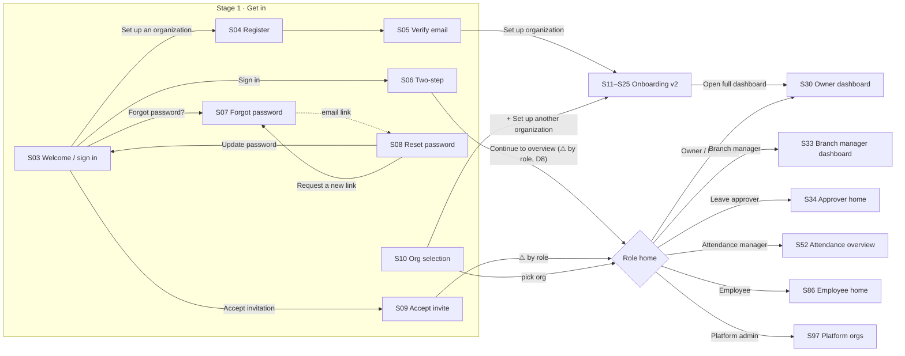
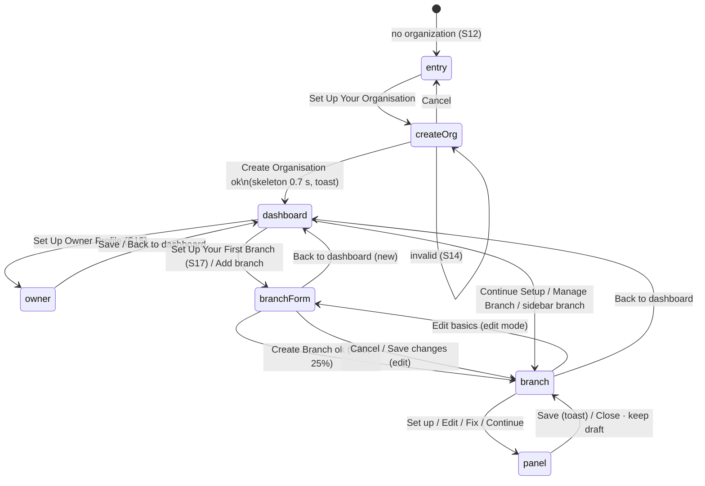
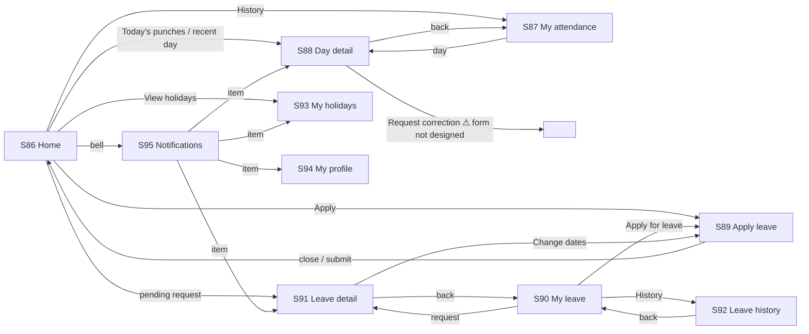

# Navigation Flows

Links below are **confirmed** from the `href`s and scripts in the canvas boards unless marked ⚠ (proposed, because the design links to `#` or not at all). Screen IDs refer to `screen_inventory.md`.

## 1. Whole-app map

Post-sign-in routing rule (PRD §4.2–4.3, proposed): verify membership and status server-side → if the user belongs to more than one organization, show S10 (or use last-used org) → otherwise go to the role's home above. A user with no organization goes to onboarding S12.

## 2. Get-in details

| From | Action | To | Notes |
|---|---|---|---|
| S03 | "Set up an organization" card | S04 | |
| S03 | Sign in | S06 | Generic error stays on S03 |
| S03 | Forgot password? | S07 | |
| S03 | Accept invitation | S09 | |
| S04 | Logo / Sign in | S03 | |
| S04 | Create account | S05 | ⚠ link not drawn; implied by guide |
| S05 | Use a different email | S04 | |
| S05 | Set up organization (after success) | S11/S12 | |
| S06 | Sign in as someone else | S03 | |
| S06 | Continue to overview | S30 | Replace with role routing (D8) |
| S07 | Back to sign in | S03 | |
| S08 | Request a new link | S07 | Expired state |
| S08 | Update password | S03 | |
| S09 | Not you? | S03 | |
| S09 | Accept and join | S10 or role home | |
| S10 | Sign out | S03 | |
| S10 | + Set up another organization | S11 | |

## 3. Onboarding v2 (S11–S29) — confirmed state machine

### 3.1 Screens and transitions

Screen states drawn as boards: `noOrg` S12 · `createOrg` S13 · `createOrgError` S14 · `ownerPending` S15 · `ownerForm` S16 · `ownerDone` S17 · `branchForm` S18 · `branchFormError` S19 · `branchNew` S20 · `branchPartial` S21 · `branchDone` S22 · `multi` S23 · `returning` S24 · `loading` S25.

### 3.2 Dashboard setup card

Three steps: Organisation created (always done) → Set up owner profile → Set up your first branch. The primary button moves to the first unfinished step. The card disappears once all three are done; the page then shows branch cards with independent progress and quick actions (Add branch always; Configure policies if any branch < 100 %; Manage employees once a branch exists; View attendance and Open full dashboard once any branch is 100 %).

Status line logic:
- no owner → "Your workspace is created. Add your owner profile, then your first branch."
- no branch → "Owner profile saved. Set up your first branch so your team can start."
- all ready → "Your branch is ready. Add employees whenever you like." / "All N branches are ready."
- else → "R of N branches ready. Finish the rest whenever it suits you."

### 3.3 Progress formula (per branch)

| Part | Weight | Complete when |
|---|---|---|
| Basic details & working hours | 25 % | name, address, city, 6-digit PIN, at least one open day, every open day closes after it opens |
| Attendance rules | 20 % | method chosen; grace 0–120, early 0–240, half-day 0–480 minutes |
| Holiday calendar | 15 % | a source chosen (Gujarat / National / Start empty) |
| Leave policies | 20 % | approval route chosen and at least one leave type on (with days > 0 unless unpaid) |
| Roles & permissions | 15 % | "I'll manage it for now", or "Invite a branch manager" with a valid email |
| Final review | 5 % | branch marked ready **and** the five parts above still valid |
| Reminders & notifications | optional | never affects % or completion |

- Percentage is recomputed from saved data on every render; never a counter.
- If a saved part becomes invalid, % drops, the part shows "Needs attention", the hero says "One step needs attention — X changed and is no longer complete, so progress went down. Fix it to continue.", and the main button becomes "Fix x".
- Ring colour: green at 100 %, orange when something needs attention, blue otherwise. Status chip: Setup complete / Needs attention / Basics done (exactly 25 %) / In progress. Card button: "Continue Setup", "Complete Setup" (≥ 75 %), "View setup" (100 %).
- "Next" step = first incomplete of basic → attendance → holidays → leave → roles → review.

### 3.4 Step panels (side panel)

| Panel | Fields (defaults) | Validation on Save |
|---|---|---|
| Attendance rules | Method: Mobile app / Shared kiosk / App and kiosk (app); Late-arrival grace (10); Early-departure threshold (30); Half day if late by more than (120); Shifts: use branch hours / several shifts | "Enter 0 to {max} minutes." per field; summary "Check the highlighted values." |
| Holiday calendar | Source (Gujarat: Dussehra, Diwali, Gujarati New Year, Bhai Bij, Christmas, Uttarayan, Republic Day / National: Republic Day, Independence Day, Gandhi Jayanti / empty); observe toggle per holiday; custom holiday name + date + every year; remove custom | Add: "Add a name and a date." / "That holiday is already on the list." |
| Leave policies | Types: Casual 12, Sick 8, Earned 15 (monthly 1.25), Unpaid (off); approval: Reporting manager / Manager then HR / Only me (owner) | — (completeness only) |
| Roles & permissions | Branch manager: I'll manage it / Invite (email); manager permissions: approve leave, correct attendance, see/export reports, add/edit employees; employee permissions: punch (always on, locked), request leave, see who's off | "Enter a valid work email, or choose 'I'll manage it for now'." + "Add the manager's email to send the invitation." |
| Reminders & notifications | Punch-in reminder, Daily missing-punch summary (10:00), Weekly leave digest | — |
| Final review | Rows for each part with ✓ / ! / – and Fix / Set up links | Save button "Mark branch ready" disabled until the five required parts are complete |

Panel behaviours: opens with kept draft → else saved value → else defaults; "Copy from {branch}" for up to two other branches whose same part is complete (roles copy resets manager to owner) → toast "Copied from X — review, then save"; closing with changes keeps a draft and labels the button "Close · keep draft"; reopening shows a draft notice with Discard; Save is busy for ~0.6 s then toasts "X saved · Branch is N% set up" or "… progress is now N% — this step needs attention" or "Branch is ready · Branch Setup Completed".

### 3.5 Resume

On return, if the owner profile is missing, there is no branch, or any branch is under 100 %, the dashboard shows the "Welcome back" banner pointing at the last opened branch/step (or the next incomplete step). "Later" dismisses it for the session.

### 3.6 Exits from onboarding

Sidebar: Employees (S39), Attendance (S52), Leave (S57), Settings (S80); org menu: Switch organisation (S10), Roles & Permissions (S67); bell → S76; sign out → S03; branch "View Branch" → S38; quick actions → S39, S52, S30.

## 4. Admin modules

```mermaid
flowchart TB
  D[S30 Dashboard] -->|View/Continue setup| OB[Onboarding branch]
  D -->|headcount bar| BD[S38 Branch details]
  D -->|Open inbox / approval row| LA[S57 Leave approvals]
  D -->|Needs attention| AT[S53 Attendance records]
  D -->|+ Add employee| AE[S43 Add employee]

  subgraph Org[Organisation & branches]
    OP[S35 Org profile] -->|View history| AL[S77 Audit log]
    BR[S36 Branches] -->|Create branch| BF0[S18 short branch form]
    BR -->|row| BD
    BR -->|Edit| BF[S37 Full branch form]
    BR -->|setup %| OB
    BD -->|Edit branch| BF
    BD -->|Continue setup| OB
    BF -->|Save / Cancel / close| BD
  end

  subgraph People
    EM[S39 Directory] -->|row| EP[S42 Employee details]
    EM -->|Add employee| AE
    EM -->|Import| IU[S46 Upload]
    EP -->|Edit| EE[S44 Edit employee]
    EE -->|Cancel / save| EP
    AE -->|close / save| EM
    FB[S45 Field builder] -->|back| SET[S79 Settings]
  end

  subgraph Import[Employee import]
    IU --> IM[S47 Mapping] --> IV[S48 Validate] --> ID[S49 Duplicates] --> IC[S50 Confirm] --> IR[S51 Results]
    IM -->|Back| IU
    IV -->|Back to mapping| IM
    ID -->|Back to validation| IV
    IC -->|Back| ID
    IR -->|Import fixed rows| IU
    IR -->|View new employees| EM
  end

  subgraph Attendance
    AO[S52 Overview] -->|branch row| AT
    AO -->|Open queue| MP[S54 Missing punches]
    AO -->|missing item| CO[S55 Correction]
    AT -->|Correct attendance…| CO
    MP -->|Correct / Review request| CO
    MP -->|name| EP
    CO -->|Cancel / Back to queue| MP
    MS[S56 Monthly summary] -->|Correct| CO
  end

  subgraph Leave
    LR[S61 Requests] -->|request id| LA
    LA --- LT[S58 Types] --- LP[S59 Policy] --- LB[S60 Balances]
  end

  subgraph Holidays
    HC[S62 Calendar] -->|holiday| HF[S64 Holiday form]
    HD[S63 Holiday list] -->|Add / Edit| HF
    HF -->|Cancel / save| HD
    HD --- HI[S65 Import/export] --- SA[S66 Schedules]
  end

  subgraph Access
    RD[S67 Roles] -->|Create / name / Edit| RE[S68 Edit role]
    RD -->|people count| UR[S70 People & access]
    RE -->|Manage| UR
    RE -->|back| RD
    UR --- IN[S71 Invitations]
  end

  subgraph Reports
    RC[S73 Report center] -->|View results| RR[S74 Results]
    RR -->|Change filters| RC
    RC --- EH[S75 Export history]
    AL -->|summary| AE2[S78 Audit event]
    AE2 -->|back / related| AL
    NO[S76 Notifications] -->|Notification settings| SN[S82]
  end
```

Sub-navigation (tabs) confirmed:
- Leave Management: Approvals S57 · Requests S61 · Balances S60 · Leave types S58 · Policy S59
- Holidays & Calendar: Calendar S62 · Holiday list S63 · Import/export S65 · Schedules S66
- Roles & Permissions: Roles S67 · People & access S70 · Invitations S71
- Reports & Analytics: Report center S73 · Export history S75
- Settings index: Organization S35 · Branches S36 · Work schedules S81 · Attendance policy S79 · Leave policy S59 · Employee fields S45 · Notifications S82 · Security S83 · Data & export S84 · Branding & localization S85 (S80 is the overview)

## 5. Role shells

| Role | Sidebar (confirmed) | Home |
|---|---|---|
| Owner | Overview, Organization, Branches, Employees, Attendance, Leave Management, Holidays & Calendar, Roles & Permissions, Reports & Analytics, Settings, Audit Log (+ Notifications on some boards) | S30 |
| HR admin | Overview, Employees, Attendance, Leave Management, Holidays & Calendar, Reports & Analytics, (Notifications), Settings, Audit Log | S30 |
| Branch manager | Branch dashboard, Employees, Attendance exceptions, Leave approvals, Holidays, Branch reports | S33 |
| Attendance manager | Attendance overview, Records, Missing punches, Corrections, Monthly summary, Attendance exports | S52 |
| Leave approver | ME: Home, My attendance, My leave, Holidays · MY TEAM: Approvals, Team calendar ⚠ | S34 |
| Employee (phone) | Bottom tabs: Home, Attendance, Leave, Holidays, Profile | S86 |
| Platform admin | Organizations, Support access ⚠, Plans & billing ⚠, Platform audit ⚠, System status ⚠ | S97 |

Opening a page outside the role's permissions shows S72 inside that role's own shell.

Responsive shell (design-system breakpoints): ≥ 1024 full sidebar (248 px) · 768–1023 icon rail (72 px, expandable) · < 768 top bar with hamburger → drawer (S32), branch scope selector inside the drawer.

## 6. Employee self-service (phone)

Bottom tabs: Home S86 · Attendance S87 · Leave S90 · Holidays S93 · Profile S94 (two tab links are `#` in EmpHome; D7).

Approver path (S34): Approve / Reject… inline on the card; the Leave Approver also uses S57-style decisions. Branch manager path (S33): All approvals → S57.

## 7. Platform admin

S97 row → S98 · S98 back → S97. Support access: owner approves a timed read-only session → "Open workspace (read-only)" ⚠ (workspace view not designed) → End session now. Suspend → typed org-ID confirmation.

## 8. Cross-cutting states (S96)

| State | Recovery action → target |
|---|---|
| Empty, first run (employees) | Import spreadsheet → S46 · Add employee → S43 |
| Empty, all done (approvals) | See decided requests → S61 |
| Empty, expected (holiday) | View holiday → S63 |
| Filters return nothing | Change filters → S73 / clear filters |
| Page didn't load | Try again (reference id shown) |
| Record not found (404) | Go to directory → S39 |
| Offline punch | Kept on device, syncs later (⚠ conflicts with "never show success until server confirms" — Q-09) |
| Session expired | Sign in again → S03, unsaved form kept |
| Save conflict | Compare changes / Discard mine |
